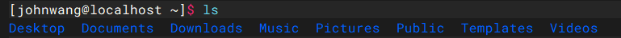
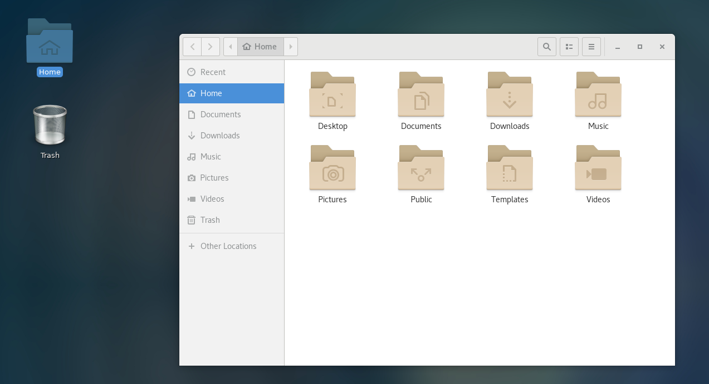
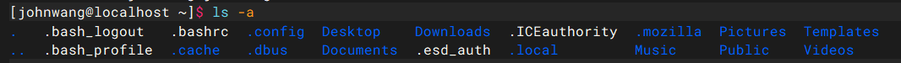
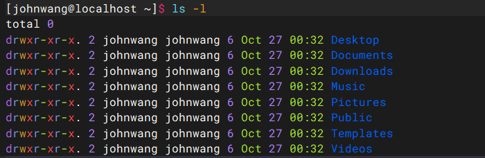
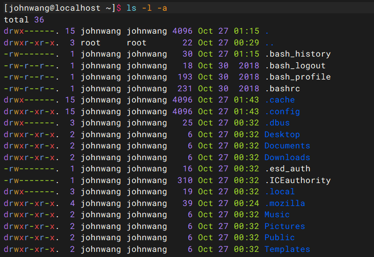
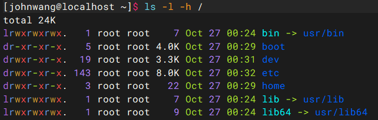

# Linux零基础网课入门笔记

## 第一章   Linux基础命令

### 1.1   Linux的目录结构

**Linux的目录结构是一个树型结构**

Windows可以有多个盘符，比如C盘，D盘，E盘

Linux只有一个根目录 **/**，**所有文件都在根目录下面**

- Windows文件路径示例：C:\Users\21290\Desktop\test.txt
- linux的文件路径示例：**/user/local/hello.txt**

### 1.2   Linux命令入门

#### 1.2.1   Linux命令基础

Linux命令的通用格式：

```
command [-options] [parameter]
```

- command 命令本身
- -option 命令的一些选项，可以控制命令的行为细节，非必填
- parameter 命令的参数，多数用于命令的指向目标等，非必填

比如

```
ls -l /home/narukami
```

**ls**是命令本身，**-l**是选项，**/home/narukami**是命令的指向目标

意思为，以列表的形式显示/home/narukami目录里的内容

#### 1.2.2   ls命令入门

ls命令的作用就是列出目录下的内容，语法细节如下：

```
ls [-a -l -h] [linux路径]
```

当不使用选项和参数时，表现形式如下



Q：直接输入ls命令，列出当前目录下的内容，当前目录是哪一个目录？

A：**HOME目录**，每个Linux操作系统用户在Linux系统中的个人账户目录，路径为**/home/用户名**



#### 1.2.3   ls命令的参数和选项

##### ls -a命令

**all的意思，列出全部文件，包含隐藏的文件/文件夹（以 . 开头的，在Linux里就是隐藏文件，能自动隐藏）**



Q：最左边 . 和 .. 什么意思？

A：在 Linux 的每一个目录里，都**默认自带**这两个特殊的隐藏目录

- **. （单个点）**：代表**“当前目录”**，比如你想运行当前目录下的某个脚本，可以用 `./脚本名`，这里的 `.` 就是告诉系统“在当前目录找”
- **.. （两个点）**：代表**“上一级目录（父目录）”**，比如你现在在 `/home/johnwang` 目录下，输入 `cd ..`，你就会退回到 `/home` 目录

Q：为什么有的蓝，有的白？

A：这是因为你的 CentOS 终端设置了**颜色别名（Color Aliases）**，不同的颜色代表不同类型的文件，**蓝色的字**通常代表**目录（文件夹）**，**白色的字**通常代表**普通文件**


##### ls -l命令

**以列表（竖向排列的形式）展示内容，并展示更多信息**



- total 0：当前目录下所有文件和文件夹（包含隐藏文件）实际占用磁盘空间为0
- d：代表文件类型，d表示这是一个**目录（Directory/文件夹）**，如果是 **-** ，则为普通文件
- rwx：代表**文件所有者（Owner）**的权限，r是read，w是write，x是execute，分别代表读，写，执行，说明johnwang对这个文件夹有读、写、执行的权限
- r-x：代表**所属组（Group）**的权限，说明同组用户只有读和执行权限，没有写权限（缺少w）
- r-x：代表**其他用户（Others）**的权限，说明同组用户只有读和执行权限，没有写权限（缺少w）
- r-x后面那个点看见没，那玩意是**安全上下文（SELinux）**标识，如果是+号通常代表有 ACL 权限
- 2：代表这个目录下包含的**子目录数量**
- johnwang：表示这个文件夹归属于哪个用户，**所有者（Owner）**
- johnwang：表示这个文件夹属于哪个用户组，Linux 在创建用户时，默认会创建一个同名用户组
- 6：代表文件占用的空间大小（单位是字节 bytes），对于 Linux 的文件夹来说，这个数字通常不是里面文件的总大小，而是记录这个文件夹结构本身（元数据）所占用的空间。所以空文件夹通常也有 6 或 4096 字节
- Oct：最后修改时间（Month）
- 27：最后修改时间（Day）
- 00:32：最后修改时间（Time）


##### ls命令选项的组合使用

语法中的选项是可以组合使用的，比如-a和-l可以组合




##### ls -h命令

- 以易于阅读的形式，列出文件的大小，如K，M，G


- 必须要搭配 -a ，-l 来使用




